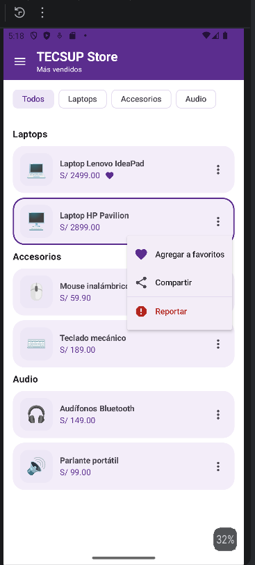
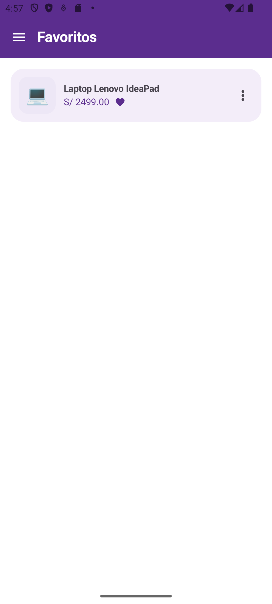
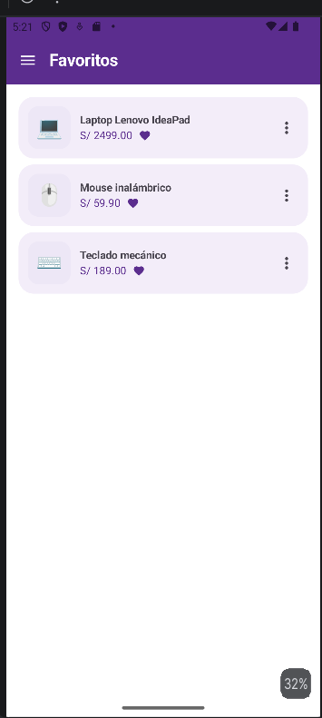
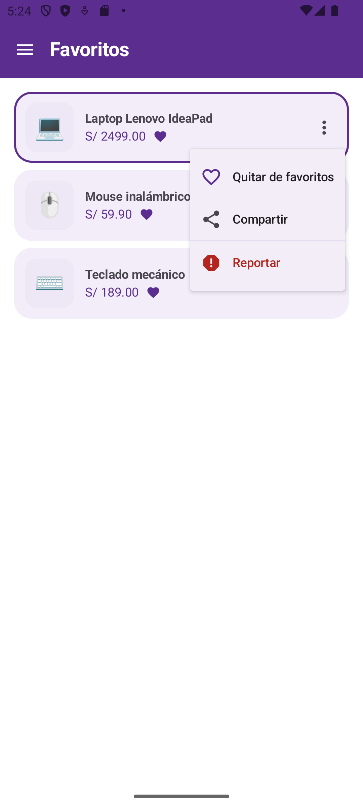

# PROMPTS.md — Laboratorio 06, Fase 2 (rama `mejora-ia`)

**Alumno:** Jordan Abad
**Curso:** Programación en Móviles — 4to ciclo
**Laboratorio:** 06 — Menú y Navegación (DropdownMenu + NavigationDrawer)
**Asistente de IA:** Claude (Anthropic)
**Rama:** `mejora-ia`, creada a partir de `main`
**Repositorio:** `lab06-tecsup-store`

## 1. Mejora obligatoria

Agregar un **badge con contador** en el ítem "Favoritos" del drawer que muestre cuántos productos marcó el usuario como favorito desde el `DropdownMenu` de cada producto. La mejora conecta las dos piezas del laboratorio: una acción en el menú contextual de un producto debe reflejarse visualmente en el drawer de navegación.

## 2. Plan de commits de la rama

- **N1:** estado de favoritos elevado y conectado al menú de cada producto.
- **N2:** pantalla Favoritos con la lista real de productos marcados.
- **N3:** badge con contador en el ítem Favoritos del drawer.
- **N4:** corazón en tarjetas favoritas y opción "Quitar de favoritos".
- **N5:** documentación de prompts, correcciones y evidencias.

## 3. Prompts utilizados

### Prompt 1 — Estado compartido de favoritos (commit N1)

**Prompt:** Teniendo el documento del laboratorio, la mejora obligatoria es un badge con contador en el ítem "Favoritos" del drawer, que refleje los productos marcados desde el DropdownMenu. Ya estoy en la rama `mejora-ia`, empecemos con el primer commit en orden y colócale N1.

**Respuesta de la IA:** Propuso aplicar *state hoisting* (elevación de estado). La lista de ids de favoritos se crea una sola vez en `AppNavegacion` con `mutableStateListOf<Int>()`, que es el ancestro común del menú de cada producto y del drawer. Desde ahí se pasa hacia abajo mediante parámetros: `TiendaScreen(favoritos, onToggleFavorito)` y `ProductoCard(producto, esFavorito, onToggleFavorito)`. El menú de cada tarjeta ya no guarda nada: solo notifica el evento hacia arriba.

**Correcciones realizadas:**
- En un primer intento (en otro equipo, antes de rehacer la rama) la IA entregó la modificación de `ProductoCard.kt` como ediciones parciales. No se aplicaron todas y Android Studio marcó dos errores en `TiendaScreen.kt`: `No parameter with name 'esFavorito' found` y `No parameter with name 'onToggleFavorito' found`. La causa era que `ProductoCard` conservaba su firma anterior. Se corrigió reemplazando el archivo completo, y desde ese punto se trabajó con archivos completos para evitar versiones mezcladas.
- Se verificó que el mensaje del `Toast` se calcule con el valor de `esFavorito` previo al cambio, para que diga "agregado" o "quitado" según la acción realizada.

**Evidencia:**

**Commit asociado:** `N1: Eleva el estado de favoritos a AppNavegacion y lo conecta con el menu de cada producto`

### Prompt 2 — Pantalla Favoritos con lista real (commit N2)

**Prompt:** Vamos por el commit 2.

**Respuesta de la IA:** Creó `FavoritosScreen.kt`, que filtra `productosEjemplo` por los ids guardados en el estado compartido y los muestra con el mismo componente `ProductoCard`. Si no hay favoritos, muestra un estado vacío con el mensaje "Aún no tienes favoritos". Reutiliza el estado elevado en N1, por lo que no se duplicó información.

**Correcciones realizadas:**
- La función `FavoritosScreen()` original vivía sin parámetros dentro de `PantallasSecundarias.kt`. Se eliminó de ese archivo y se movió a su propio archivo con los nuevos parámetros, para evitar una declaración duplicada y cumplir con la estructura de una pantalla por archivo.
- Se actualizó `AppNavegacion` para pasar `favoritos` y `onToggleFavorito` a la ruta de Favoritos usando la misma función `alternarFavorito` que usa la pantalla Inicio.

**Evidencia:**

**Commit asociado:** `N2: Agrega pantalla Favoritos que muestra la lista real de productos marcados desde el menu`

### Prompt 3 — Badge con contador en el drawer (commit N3)

**Prompt:** Vamos por el número tres.

**Respuesta de la IA:** Usó el parámetro `badge` de `NavigationDrawerItem` junto con el composable `Badge`, mostrando `favoritos.size` únicamente en el ítem de la ruta Favoritos y ocultándolo cuando el contador es 0. Como `favoritos` es un `mutableStateListOf`, Compose recompone el drawer automáticamente cada vez que el menú de un producto agrega o quita un favorito, sin necesidad de actualizar nada manualmente.

**Correcciones realizadas:**
- El `Badge` de Material 3 usa por defecto el color de error (rojo), que no concuerda con la paleta morada del diseño. Se definieron explícitamente `containerColor = primary` y `contentColor = onPrimary`.
- Se comprobó que el badge no aparezca con contador en cero y que baje de valor al quitar favoritos desde cualquiera de las dos pantallas.

**Evidencia:**

**Commit asociado:** `N3: Agrega badge con contador de favoritos en el item Favoritos del drawer`

### Prompt 4 — Corazón en tarjetas y "Quitar de favoritos" (commit N4)

**Prompt:** Vamos con el N4.

**Respuesta de la IA:** Modificó `ProductoCard` para que, cuando el producto es favorito, muestre un corazón pequeño junto al precio. Además, la primera opción del `DropdownMenu` cambia según el estado: "Agregar a favoritos" con corazón lleno si no está marcado, y "Quitar de favoritos" con corazón de contorno (`FavoriteBorder`) si ya lo está.

**Correcciones realizadas:**
- El texto fijo "Favoritos" del menú de los commits anteriores se reemplazó por un texto dinámico según `esFavorito`, para que la acción sea clara para el usuario.
- El ícono `FavoriteBorder` pertenece a la librería `material-icons-extended`, que ya estaba agregada en la Fase 1, por lo que no requirió cambios en Gradle.

**Evidencia:**

**Commit asociado:** `N4: Agrega corazon en tarjetas favoritas y opcion Quitar de favoritos en el menu`

### Prompt 5 — Documentación del proceso (commit N5)

**Prompt:** Vamos por el PROMPTS.md, recuerda que también colocaré imágenes.

**Respuesta de la IA:** Generó este archivo con la estructura: plan de commits, prompt, respuesta, correcciones y evidencia por cada hito, más una reflexión final. Indicó crear la carpeta `capturas/` en la raíz del repositorio para que las imágenes se vean en GitHub mediante rutas relativas.

**Correcciones realizadas:** Se reemplazaron los nombres de las capturas por nombres sin espacios y se verificó que cada imagen quedara dentro de `capturas/` y en el mismo commit que este archivo.

**Commit asociado:** `N5: Documenta prompts, correcciones y evidencias de la mejora con IA en PROMPTS.md`

## 4. Reflexión: ¿qué tuve que corregir del código generado por la IA?

1. **Consistencia entre archivos.** Los errores más importantes no estuvieron en la lógica sino en la sincronización: cambiar la firma de un composable obliga a actualizar todas sus llamadas. Aprendí a pedir y reemplazar archivos completos en lugar de ediciones parciales.
2. **Estilo y diseño.** La IA propuso componentes funcionales con valores por defecto de Material 3 (por ejemplo, el color rojo del `Badge`) que había que ajustar a la paleta del diseño de referencia.
3. **Arquitectura del estado.** La IA acertó al elevar el estado a un ancestro común, que es justamente lo que el laboratorio pide entender: el menú de un producto (alcance local) y el drawer (alcance global) se comunican a través de un estado compartido, no entre sí directamente.
4. **Validación propia.** Cada commit se probó en el emulador antes de subirlo: agregar, quitar, volver a agregar y verificar que el contador del drawer coincida con la lista de la pantalla Favoritos.